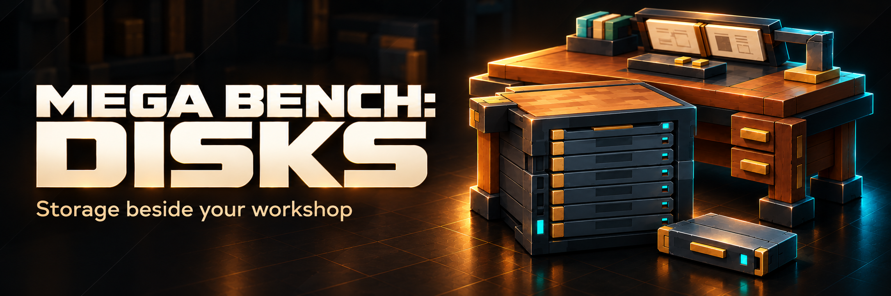
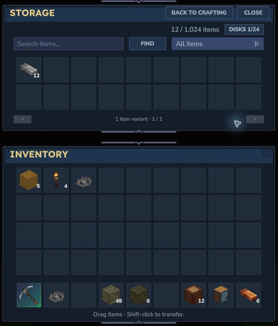

# Mega Bench: Disks

[Player guide](https://jkswoods.github.io/mega-bench-disks/) · [Downloads](https://github.com/jkswoods/mega-bench-disks/releases) · [Issues](https://github.com/jkswoods/mega-bench-disks/issues)



Add searchable disk storage beside Mega Bench and craft directly from your stored ingredients.



*Actual Hytale 0.7.5: distinct Storage and inventory panes, with one mounted disk in a three-rack group. Banner artwork is promotional.*

- Start with a 1K disk and upgrade through 4K, 16K and 64K while keeping its identity and contents.
- Connect up to 16 owned Drive Racks face to face, including vertical stacks. Eight bays per rack means up to 128 disks.
- Search one pooled inventory. Drag items or Shift-click to transfer; metadata and durability variants remain distinct.
- Use stored ingredients in personally unlocked Mega Bench recipes, with native crafting time, payment, outputs and cancellation.

## Get started

Install the compatible Disks JAR and required companion API1 [Mega Bench](https://github.com/jkswoods/mega-bench/releases) build named in its release notes. **Mega Bench 0.2.1 and earlier are incompatible.** Keep only one copy of each mod. Back up world and player data first.

Mine Memorite underground in newly generated default home-world terrain. At the stock Workbench, make Memory Wafers, a blank core, casing and disk, then a Drive Rack. Put the rack against the front/back long edge of Mega Bench. Open the bench and choose **Open storage** in the lower rack bar. Drag a disk into Storage and confirm mounting, then store ingredients. Disk management is accessible from Storage.

[Full installation and first-session guide](https://jkswoods.github.io/mega-bench-disks/hytale0.7/).

## Experimental Alpha

Declared Hytale compatibility is **>=0.7.4 <0.8.0**; native single-player checks used **0.7.5**. Actual two-client ownership/concurrency tests, optional Backpack checks and human visual/listening review remain pending. Use a disposable test world. Recipes, balance, behaviour and saved data may change before a stable release.

Storage is owner-only. Cables, chest import/export, remote access and shared-owner disks are outside this version. Disk contents belong to the saved world: transfer the whole world/player data when moving a workshop to another machine.

## Building

Use JDK 25, the official Hytale SDK matching `config/target.json`, and the Mega Bench binary matching `config/mega-bench.json`. These separately supplied dependencies are not bundled.

```sh
python3 tools/build.py --server-jar /path/to/Server.jar --mega-bench-jar /path/to/MegaBench.jar --java-home /path/to/jdk25
```

The build verifies fingerprints, compiles the mod, checks rack connectivity and packaged notices, and writes the installable JAR under `build/libs/`. Runtime inventory, crafting and persistence changes also need native checks; a source build alone does not certify gameplay.

`hytale0.7` holds runtime source; `docs` holds the player guide. See [contributing](CONTRIBUTING.md), [MIT license](LICENSE) and [third-party notices](THIRD_PARTY_NOTICES.md).
