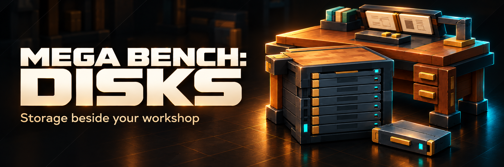

::: hero
# Mega Bench: Disks
Keep your workshop ingredients on disks and craft directly from storage.
::: button title:"Read the Hytale 0.7 guide" url:"/hytale0.7/" icon:book-open
::: /hero

::: card title:"Hytale 0.7 · Latest supported family" icon:git-branch
Declared compatibility: **>=0.7.4 <0.8.0**. Native single-player checks used Hytale **0.7.5**. Requires Mega Bench with companion API1; read the selected file's dependency requirements.
::: /card

Experimental Alpha: back up your world and player data. Recipes, balance, behaviour and saved data may change before a stable release. Actual two-client ownership/concurrency testing and human visual/listening review remain pending.
