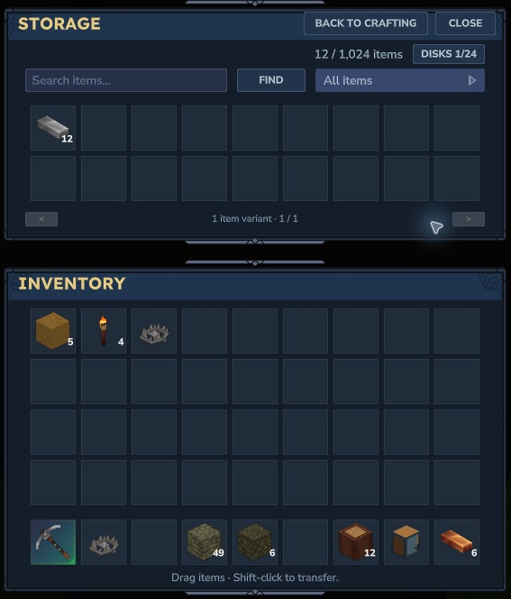

# Your first disk

1. Make a stock Workbench. Gather Iron, Copper and wood trunks, and take an iron pickaxe underground. Memorite occurs in **newly generated default home-world terrain**; previously saved terrain is preserved. Mine four Raw Memorite for the starter core.
2. At the Workbench's Crafting category, make eight Memory Wafers, one 1K Blank Core, a Disk Casing and a 1K Disk. [See recipes](recipes.md).
3. Craft a Drive Rack and Mega Bench. Place the first rack against the front or back long edge of the bench; rotate it with the native **R** placement control so the bays face out.
4. Open Mega Bench. Press **Open storage** in the Drive Rack bar below its crafting panels. Drag the cartridge from your inventory into the Storage pane, then confirm **Mount selected disk**.
5. Drag an ingredient stack into Storage or **Shift-click** it. Search the stored names or choose an item filter.
6. Press **Back to crafting**, personally unlock the bench/recipe you need, and craft normally. Eligible stored ingredients join your inventory ingredients; native payment, crafting time, cancellation and inventory outputs remain in charge.

*Actual Hytale 0.7.5: Storage and inventory have distinct native panes. This example has one mounted disk in a three-rack group.*

The starter disk and rack cost four Raw Memorite, fourteen Iron, ten Copper and eight wood trunks, excluding Mega Bench and the stock Workbench. Ore frequency and progression balance still need player feedback.

Next: [connect more racks](storage.md) or [upgrade your filled disk](recipes.md).
