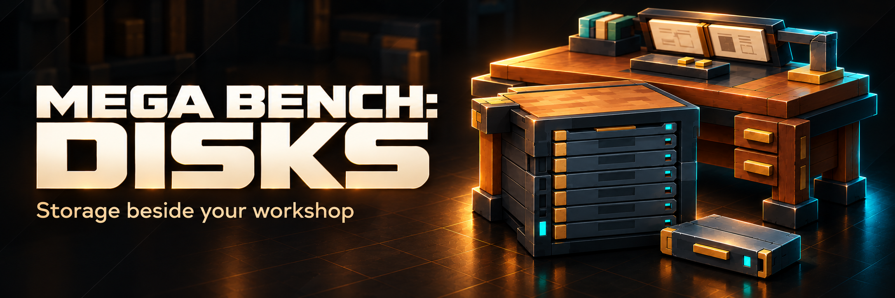
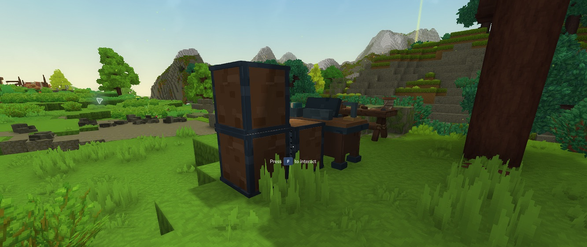

# A place for every ingredient

Mega Bench: Disks is a companion to Mega Bench. Add an eight-bay Drive Rack, mount a disk, and use your stored ingredients in personally unlocked native recipes.

::: button title:"Install the Alpha" url:"installation/" icon:download
::: button title:"Make your first disk" url:"getting-started/" icon:rocket

*Actual Hytale 0.7.5 gameplay: a vertical rack stack beside the workshop. Promotional artwork above is an illustration.*

Start with 1,024 individual items per disk, then upgrade through 4K, 16K and 64K. Connect up to 16 owned racks face to face, including vertically. Search the pooled contents from one Storage screen.

**Experimental Alpha.** Declares Hytale >=0.7.4 <0.8.0; native single-player checks used 0.7.5. Requires the companion API1 Mega Bench update. Actual two-client tests and human visual/listening review remain pending. Back up worlds and player data before upgrading; use a disposable test world first.

[Read the limits](compatibility.md) · [Download files](https://github.com/jkswoods/mega-bench-disks/releases) · [Report a problem](https://github.com/jkswoods/mega-bench-disks/issues)
