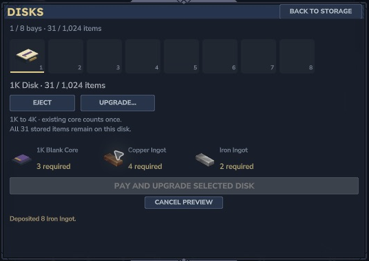

# Recipes and upgrades

All recipes below use the stock Workbench's Crafting category. Wood costs accept the native wood-trunk resource family.

| Result | Ingredients | Time |
| --- | --- | --- |
| 2 Memory Wafers | 1 Raw Memorite | 2 s |
| 1K Blank Core | 8 wafers, 4 Copper, 2 Iron | 4 s |
| 4K Blank Core | 4 blank 1K cores, 4 Copper, 2 Iron | 6 s |
| 16K Blank Core | 4 blank 4K cores, 8 Copper, 4 Iron | 8 s |
| 64K Blank Core | 4 blank 16K cores, 16 Copper, 8 Iron | 10 s |
| Disk Casing | 4 Iron, 2 Copper | 3 s |
| Storage Disk | 1 casing, 1 blank core of its tier | 2 s |
| Drive Rack | 8 Iron, 4 Copper, 8 wood trunks | 5 s |
| Mega Bench | 8 Iron, 4 Copper, 12 wood trunks | 5 s |

| Disk | Individual items |
| --- | ---: |
| 1K | 1,024 |
| 4K | 4,096 |
| 16K | 16,384 |
| 64K | 65,536 |

A starter 1K disk plus rack costs four Raw Memorite, fourteen Iron, ten Copper and eight wood trunks, excluding the Mega Bench and stock Workbench. Capacity counts individual items, rather than stacks. Matching variants combine in the browser; metadata and durability variants stay distinct. Disks cannot store other disks.

## Upgrade a filled disk

In **Storage → Disks**, select a cartridge and choose **Upgrade…**. Previewing costs nothing. Pay three additional blank cores of its current tier plus the next core's Copper/Iron assembly cost: the disk's existing core counts as the fourth. Confirm **Pay and upgrade selected disk**. Its identity and contents remain intact. A 64K disk has no further upgrade.

*Actual Hytale 0.7.4: upgrade payment preview. This older capture shows the earlier storage background; the upgrade cost and preservation behaviour still apply.*

No power or fuel is required. Higher tiers add capacity; they do not bypass Mega Bench's personal recipe unlocks.
