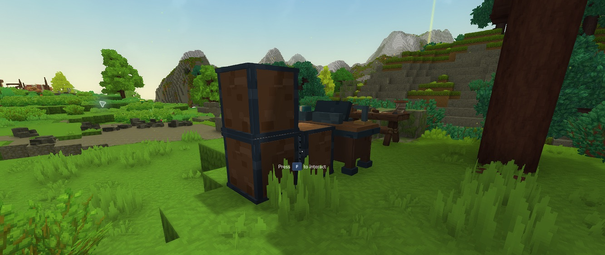

# Storage and connected racks

## Move and find items

Storage is the upper pane; your four inventory rows and separate hotbar are below. Drag an inventory stack into Storage to deposit. Drag a stored stack onto an empty or matching inventory slot to withdraw. **Shift-click** transfers quickly. Only the amount that fits moves; the rest stays at its source.

Right-click supports single-item placement. After placing one item, the held gesture ends; pick up the source remainder for another move. Stored items use pages when needed. The ordinary inventory grid does not scroll. An optional **Backpack** button switches to available bag space; native Backpack acceptance is still pending.

Search names or use the filter. Matching variants combine in the browser; metadata and durability variants remain distinct. Disks cannot store other disks.

## Place a rack group

The first rack must share a face with Mega Bench. Every additional rack must share a face with a connected owned rack; vertical stacks work. Diagonal contact does not connect. Up to **16 racks**, each with **8 bays**, form one pool: **128 disks**, or **8,388,608 individual items** if every disk is 64K.

*Actual Hytale 0.7.5. Each physical rack retains its own disk bays and contents.*

More than 16 connected racks pauses disk access until the extra racks are separated. Another player's rack does not connect or bridge your pool. Disconnecting a rack hides its capacity/items from the bench; reconnecting restores access to the same disks.

## Manage disks

Open **Disks** from Storage. Use **Prev / Next** to select a physical rack; its coordinates identify the eight bays shown. Select a mounted cartridge to eject or preview an upgrade. Ejecting returns the same disk with its contents intact. Drag a cartridge into Storage to select it for mounting.

Finish or cancel a craft before changing disks, transferring items or breaking any connected rack, including an empty bridge. Empty every bay before breaking a rack. Browsing and Cancel remain available while crafting. Physical occupancy and fill indicators describe each rack's own disks.

## Return to crafting

**Back to crafting** preserves the current recipe selection, search, quantity and scroll while the page stays open. Closing and reopening starts a fresh browse session. The original crafting category strip remains at the top; storage management lives behind its footer entry.
